# video-kit

**Write a `script.json`, get a finished social video.** Narration in a synthetic voice or your own cloned
voice, word-by-word captions, a soundtrack generated at the exact length, and scenes made for showing
technical work. On your own machine, with no paid APIs. Built to be driven by
[Claude Code](https://claude.com/claude-code); every step is also a plain command.

[](LICENSE)


<p align="center">
  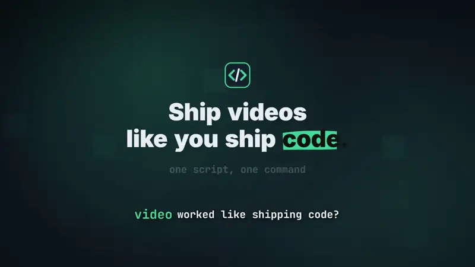
  <br><sub>Every shot above comes from <a href="projects/example-dev">projects/example-dev</a>, rendered with <code>vk build example-dev</code>.</sub>
</p>

## From script to scene

A scene is a few lines of JSON. Words in `cue` are spoken words: the line appears when the narration says it.

<table>
<tr>
<td width="58%">

```jsonc
{
  "id": "terminal",
  "say": "You write a script file and run one command.
          The kit narrates, captions, scores and renders it.",
  "terminal": {
    "title": "cmd · video-kit",
    "lines": [
      { "cmd": "vk new launch-video" },
      { "cmd": "vk build launch-video --preview", "cue": "run" },
      { "stream": ["[1/5] narration", "..."], "cue": "narrates" },
      { "cmd": "vk qa launch-video" },
      { "out": "ok  speech match  {n}% ...", "count": 98 }
    ]
  }
}
```

</td>
<td width="42%" align="center">
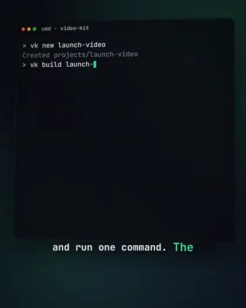
</td>
</tr>
</table>

## Scenes

<table>
<tr>
<td width="50%">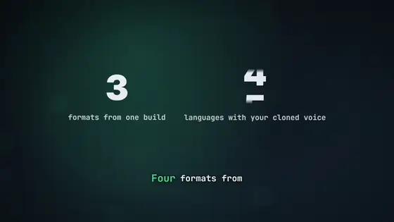<br><b>Stats</b>: numbers that roll up like an odometer and land with an underline.</td>
<td width="50%">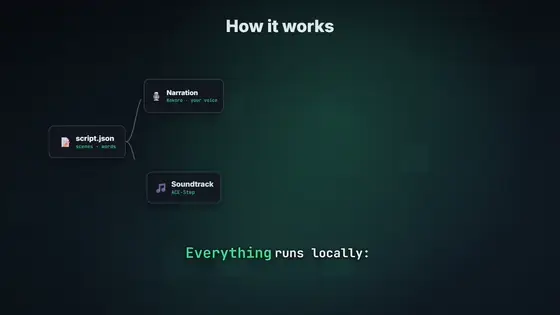<br><b>Live diagrams</b>: nodes and edges from data; packets keep flowing and light up each step as it is named.</td>
</tr>
<tr>
<td>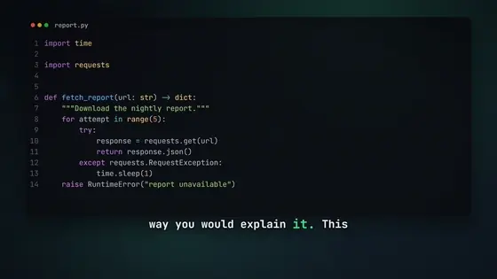<br><b>Code</b>: highlighted, with focus steps, a camera punch-in and hand-drawn marks on a spoken word.</td>
<td>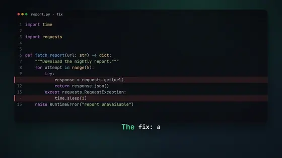<br><b>Diffs</b>: removed lines strike out and close, added ones open, on the word that names the fix.</td>
</tr>
<tr>
<td>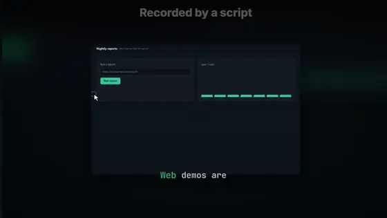<br><b>Screen demos</b>: <code>vk capture</code> records a scripted browser session; zoom and cursor follow the clicks.</td>
<td>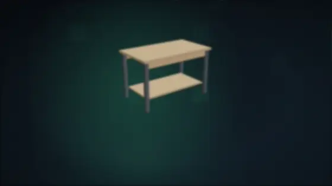<br><b>3D models</b>: any .glb on a turntable, exploded view, labels that follow their parts, a part lit on its word.</td>
</tr>
<tr>
<td>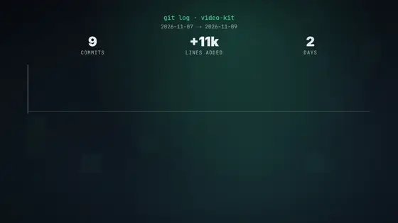<br><b>Git history</b>: commits, lines and days counted up from the repository itself.</td>
<td>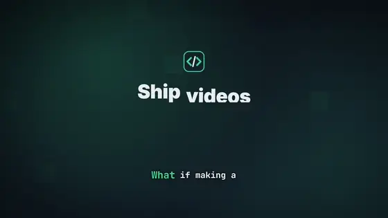<br><b>Kinetic titles</b>: words rise on an uneven rhythm, a marker sweeps the key word; over a picture or clip too.</td>
</tr>
<tr>
<td>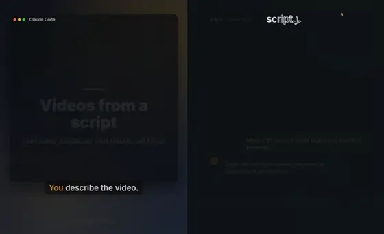<br><b>Chat and Manim</b>: a conversation that types itself, and Manim scenes fitted to the frame.</td>
<td><b>Also</b>
<ul>
<li>Photos, clips (trim, speed), PDF pages, slideshows that switch on a spoken word</li>
<li>Talking-head takes: <code>vk cut</code> removes the silences, the clip's audio becomes the captions</li>
<li>Cards for the end, with your logo</li>
</ul>
</td>
</tr>
</table>

### On every scene

- **Camera and marks**: punch-ins that snap and settle on a point; circles, underlines, boxes, arrows and
  highlights drawn by hand on a spoken word.
- **Transitions**: fade, slide, wipe, zoom, cut, and push, through and flip, which move both scenes.
- **Look**: 5 styles (clean, bold, tech, midnight, editorial) with living backgrounds, 3D windows, 4 caption
  looks, light leaks, grain and vignette.
- **Sound**: 20 CC0 effects placed on spoken words, music that ducks under the voice, beat-synced cuts,
  loudness mastered for social feeds (-14 LUFS).
- **Checks**: `vk sheet` tiles the video into a contact sheet; `vk qa` checks speech, pace, loudness,
  black frames and stretches where the picture stands still.

### One script, every format

<p align="center">
  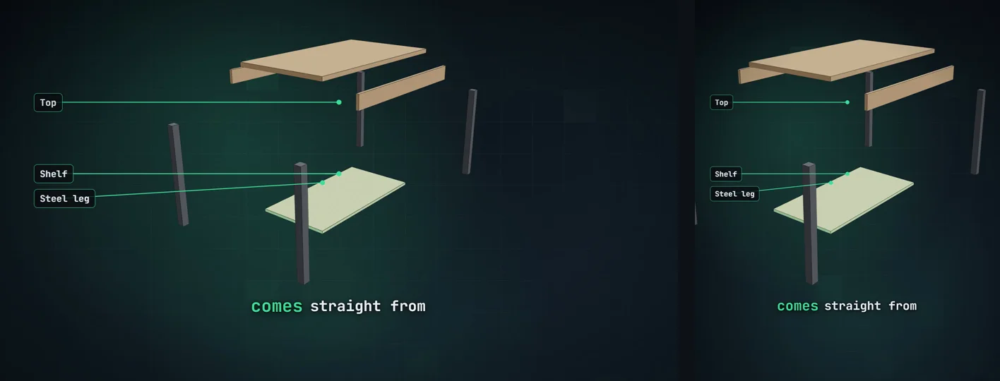
  <br><sub>16:9 and 4:5 from the same build; 1:1 and 9:16 too. Layouts adapt (diagrams turn vertical in portrait).</sub>
</p>

## How it works

```
script.json ─► narration ─► captions ─► timeline ─► Remotion render ─► MP4 + cover + SRT ─► vk qa
              Kokoro /     Whisper     scenes,      styles, captions,  -14 LUFS master       speech, pace,
              your voice /  + script    soundtrack,  transitions, sfx,                         loudness, frames
              your takes    alignment   beat sync    film look
```

The build caches every step: change one scene's narration and only that scene is voiced again.

## Getting started

Open the folder in Claude Code and say "set up the kit": the `kit-setup` skill checks your machine,
asks which voice and music you want, installs only that, and renders the examples. By hand:

```powershell
powershell -ExecutionPolicy Bypass -File setup.ps1 -Check                         # what is missing
powershell -ExecutionPolicy Bypass -File setup.ps1 -Voice synthetic -Music generate
.\vk build example --preview
.\vk sheet example --preview
```

Needs Python 3.12, Node.js 20+, uv and git. Setup downloads ffmpeg, fonts and a browser for `vk capture`;
model weights (up to ~20 GB with music) download on first use, and rendering fetches fonts from Google
Fonts. In PowerShell, run the kit as `.\vk`; in cmd, `vk` works as is.

**Windows 10/11 only** (PowerShell setup, `vk.cmd`). Tested on Windows 11 with an NVIDIA RTX 4090. Music
generation needs an NVIDIA GPU; without one the videos render without a soundtrack, or with your own music
files. Voice cloning also runs on the CPU, slowly. Synthetic voice works anywhere.

**Your data stays yours.** Your profile, brand, voice samples, music and projects live in `user/` and
`projects/`, which git ignores. Only clone your own voice, or one whose owner agreed.

## Making a video

```
vk new my-video         # then write script.json (see CLAUDE.md)
vk check my-video       # missing files, estimated length vs target
vk build my-video --preview && vk sheet my-video --preview
vk build my-video && vk qa my-video
```

With Claude Code, the `video-kit` skill does this with you: script first, your approval, then a visual plan
sentence by sentence, the render and the checks.

Examples: `projects/example` (25 s, synthetic voice, chat, Manim, generated music) and
`projects/example-dev` (the developer showcase in the clips above). Their assets (`demo.mp4`, `desk.glb`,
`logo.svg`, the small web page) and the clips in `docs/media/` were made for this repository and are MIT
like the rest.

## Stack

| Layer | Tool | License |
|---|---|---|
| Composition / render | [Remotion](https://www.remotion.dev) 4 | free for individuals and companies of up to 3 people; check [its license](https://www.remotion.dev/license) |
| Synthetic voice | [Kokoro-82M](https://huggingface.co/hexgrad/Kokoro-82M) | Apache-2.0 |
| Voice cloning | [Qwen3-TTS](https://github.com/QwenLM/Qwen3-TTS) (1.7B Base) | Apache-2.0 |
| Captions | [OpenAI Whisper](https://github.com/openai/whisper) | MIT |
| Soundtrack | [ACE-Step 1.5](https://github.com/ace-step/ACE-Step-1.5) | MIT |
| Diagrams | [Manim](https://www.manim.community) | MIT |
| 3D models | [three.js](https://threejs.org), [React Three Fiber](https://r3f.docs.pmnd.rs) | MIT |
| Code highlighting | [Pygments](https://pygments.org) | BSD |
| PDF pages | [PyMuPDF](https://pymupdf.readthedocs.io) | **AGPL-3.0** (or a commercial license from Artifex) |
| Browser capture | [Playwright](https://playwright.dev/python/) | Apache-2.0 |
| Beat detection | [librosa](https://librosa.org) | ISC |
| Fonts | Inter, Montserrat, JetBrains Mono, Playfair Display, Space Grotesk (Google Fonts) | OFL |
| Sound effects | Kenney, OpenGameArt and sounds generated by [agent-video-editor](https://github.com/kmilo93sd/agent-video-editor) | CC0 |
| Audio/video plumbing | [ffmpeg](https://ffmpeg.org), downloaded by setup | GPL |

## Docs

- [CLAUDE.md](CLAUDE.md): script.json reference, scene types, commands
- [docs/checklist.md](docs/checklist.md): from script to delivery
- [docs/voice.md](docs/voice.md): recording your voice samples
- [docs/lessons.md](docs/lessons.md): mistakes already made, and the fixes
- [CHANGELOG.md](CHANGELOG.md)

## License

[MIT](LICENSE). The sound effects in `sfx/` are CC0 1.0 (sources in
[sfx/LICENSES-source.md](sfx/LICENSES-source.md)). The tools setup installs keep their own licenses (table
above); note Remotion's terms for companies, and PyMuPDF's AGPL if you distribute the kit with it.

Issues and pull requests are welcome. The kit assembles material a project provides; generators for
a specific kind of project (CAD renders, game footage) belong in that project.
